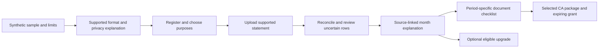

# FINNest — planned application screen inventory

These are proposed V1 user flows, **not implemented screens**. Keep the product web-first and accessible on mobile browsers.

DAY-001 review: screen scope follows [requirements](REQUIREMENTS.md). FIN-027, FIN-063, FIN-066 and FIN-067 are now V1.5 in the reconciled feature manifest and generated catalog. Daily-roadmap adjustments remain separate proposals in [decisions](DECISIONS.md).

| Screen | What users can do | Notes |
| --- | --- | --- |
| Landing page | Understand promise, limits, pricing, early access | Must avoid misleading financial/CA claims |
| Register / login | Create, verify, access, recover account | Managed authentication and audit controls |
| Privacy & preferences | Manage use purposes, AI consent, reporting period/timezone and withdrawal | No consent dark patterns; reminder preferences deferred with FIN-067 |
| Financial account manager | Add bank/card account metadata | Never collect bank-login credentials |
| Upload center | Upload supported CSV, one bank and one card PDF format; inspect support matrix | Providers pending safe fixtures; scanned/unsupported files fail gracefully |
| Import processing status | See queued, processing, complete/partial/error | Retry/fallback |
| Transaction preview | Review extracted rows and reconciliation warnings | Do not silently accept uncertain totals |
| Transaction list | Filter, search, correct, undo, inspect source | Precision and provenance |
| Money dashboard | Income, consumption spending, investments, cross-account cash flow | Explicit freshness/coverage labels |
| Spending analytics | Category/merchant trends and source drilldown | Transfer/refund treatment correct |
| Recurring costs | Review subscription/commitment candidates | Candidate not certainty |
| Unusual activity | See anomalies and acknowledge/dismiss | Not fraud detection guarantees |
| Monthly report | See what changed and why | Exportable with source data |
| Ask My Money | Ask grounded financial questions | Allowlisted queries and citations to transactions |
| Tax vault | Upload Form 16, AIS/TIS, related documents | User/private permissions |
| Tax readiness | View relevant missing documents/issues by tax period | Not a complete tax assessment |
| Tax-policy library | Read published reviewed tax changes and sources | No unapproved rule used in calculations |
| CA package | Prepare and download summary and unresolved questions | Sources and assumptions disclosed |
| CA invitation | Share selected records with time limit, revoke future access | Scope-specific consent/audit; downloaded copies cannot be recalled |
| Billing | Plan, payment, receipts, cancellation/refund | Server-side entitlement rules |
| Settings & security | Devices/sessions, export/delete, access history | Account owner only |
| Help / support | Report import errors safely | Never default-upload raw user documents to tickets |
| Administrative policy review | Review, approve and publish tax-rule metadata | Limited staff-only privileges |
| Administrative support | Inspect non-sensitive operational state | Least-privilege staff access |

## Later screens

- Financial-health components (FIN-066) and upload/monthly reminder preferences (FIN-067), V1.5.
- Additional bank adapter support (FIN-027) and recurring price-increase insights (FIN-063), V1.5.
- Tax regime and liability simulator (after independently validated engine).
- Full CA practice dashboard and client workflow.
- Net worth, assets and liabilities; financial goals; family view.
- Regulated data connections and authorized e-filing.
- Native Android/iOS when retention justifies the expense.

## DAY-005 handoff from DAY-004 — design proposal only

Use the [market analysis](research/DAY_04_MARKET_ANALYSIS.md), [pricing hypotheses](MONETIZATION.md) and [CA journey](research/DAY_03_CA_WORKFLOW.md) as inputs. No wireframes, landing page, waitlist or UI were implemented during Day 4; FIN-006's working-page acceptance remains untested.

**Recommended primary customer:** an employed Indian adult with multiple accounts/cards, a recent confusing month and an existing tax-document/CA workflow. Salary plus supplementary freelance income remains secondary. **Headline to test:** “Make sense of your monthly money. Keep your tax documents ready.” This is candidate copy, not an approved brand tagline or a claim that features are live.

Three problem hypotheses to design around: (1) ambiguous transactions/transfers obscure consumption and cash movement; (2) financial-data access/privacy concerns may discourage upload; (3) scattered records and repeated uploads may make tax preparation burdensome. These are interpretations of exploratory signals from three employed survey respondents, not observed upload refusals, population findings or proven severity.

Design failure branches as first-class screens: unsupported/scanned PDF, canceled upload, duplicate, processing failure, incomplete coverage, unreconciled balance, wrong period, denied AI consent, missing document, expired grant and revocation. No silent success or assumption of complete savings. Never ask for bank/portal credentials. Provider-specific import choices remain pending safe fixtures.

Before upload, disclose purposes, supported formats, account/period coverage, encryption/access controls actually verified, processor/AI boundaries, retention/deletion and backup exceptions, safe support access, user choices and withdrawal. Do not market proposed controls as certifications. Before sharing, show the exact recipient/documents/snapshot, expiry/download scope and the inability to recall downloaded copies. Before payment, show total price, period, limits, renewal/refund terms and exclusions. Qualified review must resolve [regulatory questions](REGULATORY_REVIEW.md) before public promises/real data.

Proposed navigation groups the existing screen inventory: **Overview; Transactions/Imports; Reports; Tax Documents & Readiness; CA Sharing; Settings & Billing**. Ask My Money can sit within Reports/Overview rather than dominate first use. This changes presentation emphasis only, not feature scope or architecture. Keep staff-only policy/support screens outside customer navigation.

First pricing research: compare Free, the existing ₹999/year Plus hypothesis and ₹499 named-period Tax Pack after a sample outcome; ask what actual alternative they replace. Test annual-commitment objections and a one-time report concept without adding an unapproved price/SKU. Later paid behavior requires approved entitlements, working safeguards, merchant terms and a predefined experiment; clicks/positive survey answers are insufficient.

Day 5 readiness checklist:

- [ ] Founder selects/adjusts the clarity-first positioning and sample headline (D4-01).
- [ ] Design the complete sample → upload → reconciliation → explanation task, including all failure/privacy states; no implementation claim.
- [ ] Explain tax checklist completeness separately from legal tax correctness; retain Day 3 professional-review questions.
- [ ] Annotate Free/Plus/Tax Pack boundaries as pending where unresolved (D4-02); do not silently decide paywalls.
- [ ] Specify optional, minimal-contact waitlist consent/storage/retention; no financial-document collection or live publishing without approval.
- [ ] Include measured-task prompts and dissent/refusal capture; no invented results.
- [ ] Resolve brand strategy or keep visibly provisional branding in private drafts; professional clearance remains a public-launch gate.
- [ ] Preserve reviewed external-evidence limits, V1 scope and Day 60/85 planning targets.

The materials are sufficient to begin Day 5 design after founder review; public rollout, live data collection and professional/tax/brand approval are not ready. Day 4 does not start Day 5 work automatically.
