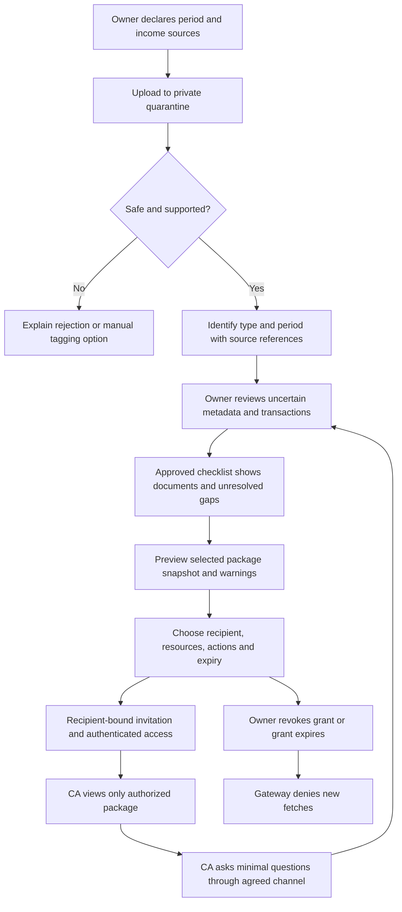

# FINNest — DAY-003 V1 CA handoff proposal

**2026-10-11 · Issue #11 · Design hypotheses, not implemented or CA-approved.** Read the [discovery plan and acceptance proposal](DAY_03_CA_DISCOVERY.md), [document/readiness matrix](../tax/DOCUMENT_READINESS.md), [requirements](../REQUIREMENTS.md), [security](../SECURITY.md) and [tax governance](../TAX_POLICY.md). FINNest organizes evidence for a professional; it does not replace a CA, choose a return/regime, compute final tax or file returns.

## Problem and evidence boundary

Hypothesis: a salaried person with multiple accounts, employer records, investments or supplementary income sends fragmented documents/messages to a CA, leading to repeated questions about periods, missing records and unexplained receipts. The CA may need a source index and unresolved questions more than another dashboard. Neither workflow nor time savings has been professionally validated.

The [Day 2 pilot](DAY_02_SURVEY_PILOT.md) reports three employed respondents and two students. All three employed respondents selected transaction/transfer confusion and tax-reporting uncertainty; two were unsure what to send a CA. These prompted self-reports justify discovery questions, not a representative demand claim or evidence that CAs want a workspace. No CA interviews or reviewer appointment are documented.

Proposed information for a CA to review: selected period and user-declared income circumstances, document inventory and coverage, source-linked receipt summaries, corrections, unresolved credits/transfers/refunds, possible missing accounts and professionally relevant exceptions. Ask the CA which fields are useful before fixing a package contract. A salary credit is not gross salary; a security-sale receipt is not taxable capital gain.

## Deliberately small V1 boundary

| Existing scope | Proposed interpretation, subject to review |
| --- | --- |
| FIN-077–080 | Private uploads, period tags, limited reviewable Form 16 metadata and AIS/TIS identification. No general tax-document parsing or portal access |
| FIN-081–089 | Period-specific approved checklist with reasons, source/version metadata, explicit unknowns and professional-review gates |
| FIN-090 | One owner-selected annual package snapshot: summary, inventory, limitations and unresolved questions |
| FIN-091–096 | Named recipient, selected resources, explicit view/download actions, expiry, immediate future-fetch revocation and owner-visible access history |

**Clarification proposal:** V1 uses a numbered question list included in the selected package, with questions exchanged through the user's existing agreed CA communication channel. The user records answers/corrections in FINNest's existing correction/checklist workflow and explicitly creates/re-shares a new snapshot. CA-authored in-app messages, request queues, task assignments and reminders are not assumed part of FIN-090–096. A native request workflow would require separate scope approval. No firm dashboard, delegated staff access, client CRM, billing, tax portal credentials or multi-client workspace is designed here.

The external channel is not protected by FINNest. Share only package/item references and a minimal question there; do not automatically attach statements, amounts or narrations. The owner and CA must agree a suitable channel for any sensitive discussion outside FINNest. Do not promise that this workaround has solved secure messaging.

## Proposed journey

| Step | Proposed user/system behavior | Required failure behavior |
| --- | --- | --- |
| 1. Declare | Owner selects historical FY/AY or Tax Year and declares salary, interest, disposals and other applicable sources; allow “unsure” | Unknown residency/income/form applicability means professional review, not an invented supported checklist |
| 2. Upload | Apply the existing real-data release gate; quarantine, scan and validate file/page/size limits before processing | Unsafe files rejected; unsupported extraction can allow safe vault storage/manual tags only if the upload type itself is allowed. A rejected file is never a received checklist item |
| 3. Identify | Suggest supported type/period from content with source reference and uncertainty; owner confirms | Filename alone cannot establish type, authenticity or period. Scans get no OCR promise; ambiguous/mixed documents remain unreviewed |
| 4. Review | Display candidate fields and raw source; preserve corrections separately; distinguish amounts and transfer/card/refund semantics | Unknown credits, duplicate candidates and unmatched legs remain questions; never automatically classify them as taxable income |
| 5. Assess | Show the checklist's approved rule version, declarations, coverage and separate unresolved issues | Unsupported periods/rules show “not assessed”; not-yet-issued annual documents remain unavailable, not delinquent |
| 6. Package | Preview annual summary and exactly what the CA will see; include selected missing-item/question list | Partial data can be shared for discussion with persistent warnings; never call it filing-ready. Block unsafe or unauthorized resources |
| 7. Consent | Owner confirms recipient, exact document versions, derived report content, view/download rights, purpose and expiry | No default all-documents scope, silent future additions or invitation containing sensitive attachments |
| 8. Receive | Recipient proves control of intended identity and accepts access; account authentication is not verification of CA qualification | Forwarded invite, wrong identity, reused activation or expired invite rejected without disclosing whether another owner/resource exists |
| 9. Review | Read-only selected package through the authorization gateway; no browsing other owner data | Each page, thumbnail, export, range request and download rechecks grant/owner/expiry; failed authorization returns no document content |
| 10. Clarify | CA quotes permitted package/question references through agreed channel; user can answer, decline or mark unresolved | A question grants no extra access. Avoid sending identifiers, source narrations or attachments through ordinary notifications |
| 11. Correct/share again | User edits reviewed metadata or ledger corrections; FINNest creates a new package version | Existing snapshot remains historical, with stale-version notice; new files, answers and versions require renewed explicit selection/grant. Delete removed source derivatives per policy |
| 12. Revoke/delete | Owner revokes grant or deletes account; new fetches denied after committed revocation, including active sessions | Bytes already delivered/in flight, screenshots and downloaded copies cannot be recalled. State that limitation before sharing |

## Proposed package contract

Package content is data too. It must be previewed and scoped separately from document selection; excluding a PDF does not prevent its amounts or sensitive metadata leaking through an unrestricted summary.

- Snapshot ID/version and creation time; selected period, framework, declarations and confirmed/unknown applicability; user-approved display identity only where needed.
- Index of selected document versions using opaque references, type, issuer label, coverage, source page/row and user-review state. Keep full identifiers out of summaries and filenames by default; authorized originals may still contain them, which the preview must disclose.
- Deterministic financial summary for explicitly selected accounts/periods, with receipt income, consumption, investments, transfers, card purchases/repayments, refunds/reversals and cash flow separate. Show missing coverage, import reconciliation and calculation/correction versions. No taxable-total inference.
- Selected missing/awaiting-review items and numbered questions with reason, minimal related source references and whether owner or professional action is needed. Unselected documents' names, existence and private notes are not exposed automatically.
- Per-item provenance and limitations; document presence, user confirmation and any later scoped professional opinion are distinct states. No “CA approved” badge from opening/downloading a package.

Hypothetical clarification candidates include a transfer without the matching leg, employer reimbursement mixed with salary, a card settlement counted twice, investment redemption, an unmatched refund and a credit whose source the user cannot identify. Ask what happened; do not infer tax treatment or ask for another person's credentials. CA reviews legal classification, deductions, regime/return eligibility, residential status, capital gains, loss treatment and filing completeness outside FINNest's V1 computations.

## Sharing permissions matrix — proposed implementation requirements

All access is deny-by-default; these controls are not claimed built. Numeric invitation/grant/link TTLs and retention periods remain owner/security/legal decisions.

| Resource/action | Owner | Intended CA with active grant | Other CA/account or forwarded link | Support / tax-policy reviewer / AI |
| --- | --- | --- | --- | --- |
| List financial accounts or unselected files | Own account only | Denied | Denied | No standing access |
| Selected package and its source references | Preview/read | Read selected version only | Denied | No raw package access by default |
| View selected original | Own file | Only with explicit view scope | Denied | Exceptional support access follows existing scoped consent/audit policy; policy reviewer uses synthetic material |
| Download/export selected original/package | Own export | Only with explicit download scope | Denied | AI gets neither originals nor full package; no new AI permission is implied |
| Change transactions/checklist/period | Correct with provenance | Denied; asks owner | Denied | No autonomous changes |
| See unresolved questions | Own list | Only explicitly included items | Denied | No question text in operational logs |
| Add documents or forward/delegate grant | Owner must explicitly authorize new selection | Denied | Denied | Denied |
| Revoke/extend access | Owner; extension requires explicit confirmation | Cannot extend/widen | Denied | Emergency administrative suspension may remove access, never broaden it |
| Audit history | Own share/access events | Only current grant context needed to use it | Denied | Restricted operators get minimal operational events, not contents |

Access links expire and are recipient-bound; download capability must also go through request-time authorization. Storage-signed URLs may be internal only: a direct recipient-visible URL that still works after revocation fails FIN-093, even if it expires soon. Check each new range request; cancel queued jobs and streaming where practical, without promising recall of delivered bytes. Use private/no-store responses, avoid public caches, exclude tokens from logs and referrers, rate-limit invites, and recheck scope immediately before returning generated exports. View-only means no authorized download action, not prevention of screenshots or copying.

Audit invitation, consent scope/version, activation, allowed/denied fetch, download, expiry, revocation and package replacement with actor/resource IDs, time and outcome. Do not log document contents, PAN, amounts, question text or access tokens. Audit logging failure must not silently permit unaudited sharing; define fail-closed behavior and recovery in implementation review. Notifications contain generic access information and a safe login route only.

User withdrawal ends future sharing/processing for the withdrawn purpose. Grant expiry is not deletion. Apply approved retention and deletion across source files, derivatives, questions, jobs and caches; backup residual retention and restore deletion replay remain governed by [security](../SECURITY.md). The CA may have independent copy/retention responsibilities that counsel must establish; FINNest must not promise erasure from a recipient's systems.

## Proposed verification scenarios — not executed

Before real sharing: test two owners/two recipients, guessed resource IDs, forwarded/replayed invites, grant expiry, revoke during export/download/range fetch, stale signed URLs, cached previews, deleted source/account, new-version noninheritance, minimized notifications/audit failures and accidental summary leakage from excluded documents. Every unauthorized fetch must disclose no resource content. After correction, snapshot version/provenance must be reproducible; prior warnings cannot disappear through re-export. Recipient qualification verification and independent legal/security assessment remain separate from these engineering tests.

No architecture replacement is required: use the existing modular monolith, private objects and CA authorization gateway in [architecture](../ARCHITECTURE.md). Dependencies are identity/ownership, safe uploads, exact ledger and coverage, approved checklist rules, versioned package rendering, grants/audit and retention. Missing professional feedback does not block drafting or synthetic interface work; unapproved tax logic or unverified data controls block user-facing tax assessment and real financial-data collection. Detailed follow-up owners and acceptance are in the [discovery pack](DAY_03_CA_DISCOVERY.md).
